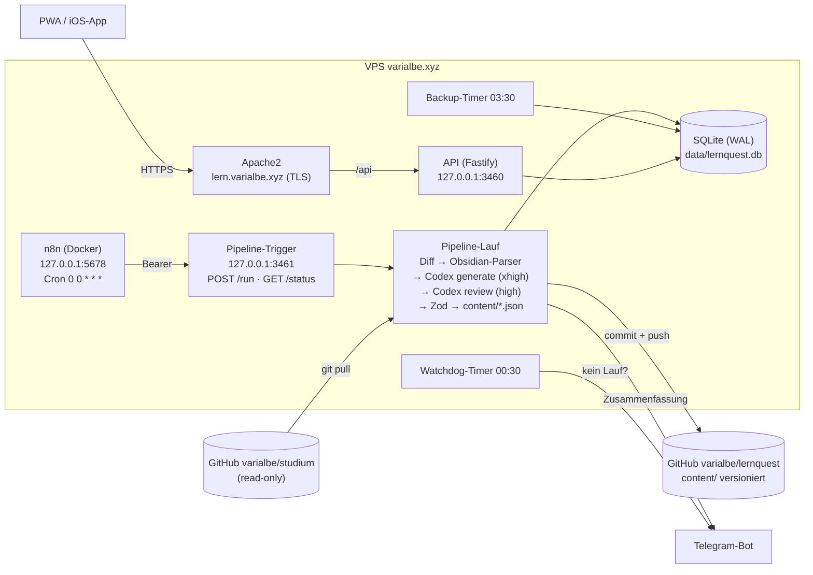

# LernQuest

Duolingo-artiges Lernquiz für **DS, EIP und ERA** (TUM). Jede Nacht um 00:00 erkennt eine Pipeline neue Vorlesungsmitschriften im privaten Repo `varialbe/studium`. Daraus erzeugt Codex CLI Multiple-Choice-Level, prüft sie in einem zweiten Durchlauf und spielt sie in die App ein. Dazu kommen Accounts, XP, Coins, Streaks, Pets, Shop und Ligen.

**App:** https://lern.varialbe.xyz · **Zugangsdaten:** `~/lernquest/CREDENTIALS.local.md` (nur auf dem Server)

## Architektur



| Ordner | Inhalt |
|---|---|
| `packages/shared` | Zod-Schemas (Quiz-Format, API-Contracts) + Spielkatalog (Pets, Shop, Achievements, Ökonomie) – single source of truth |
| `pipeline/` | CLI + Trigger-Dienst: Diff-Erkennung, Obsidian-Parser, Codex-Aufrufe, Validierung, Git, Import, Telegram |
| `pipeline/prompts/` | versionierte Prompt-Vorlagen `generate-unit.md`, `review-unit.md`, `generate-bonus.md`, `review-bonus.md` |
| `content/` | generierte Units `content/<modul>/<nr>-<slug>.json` (Quelle der Wahrheit, wird beim API-Start importiert) |
| `apps/api` | Fastify + Drizzle + SQLite: Auth, Fortschritt, Ökonomie, Ligen, Admin, Web Push |
| `apps/web` | React + Vite + Tailwind + motion + KaTeX + Mermaid, PWA, Capacitor (iOS) |
| `n8n/` | Docker Compose + Workflow „LernQuest Nightly“ |
| `deploy/` | systemd-Units, Apache-vhosts, Deploy- und Backup-Skript |
| `docs/` | iOS-Sideloading |

## Betrieb

```bash
cd ~/lernquest
pnpm pipeline dry-run                 # was wäre neu?
pnpm pipeline run                     # Normalbetrieb (macht n8n jede Nacht)
pnpm pipeline backfill                # alle Vorlesungen chronologisch nachholen
pnpm pipeline regenerate "DS/01_Vorlesungen/Diskrete Strukturen VO3.md"
pnpm pipeline bonus                   # fehlende Praxis-Level nachziehen (oder: bonus ds-03 → nur diese Unit neu)
pnpm pipeline watchdog                # lief heute schon ein Lauf?
pnpm pipeline telegram-setup          # einmalig: Chat-ID nach /start an den Bot eintragen

deploy/deploy-web.sh                  # Web-App bauen + nach /var/www/lernquest
sudo systemctl restart lernquest-api  # nach API-Änderungen
pnpm seed                             # Admin/Testuser/Einladungscode (idempotent)
pnpm test                             # alle Tests (shared, api, pipeline)
cd apps/web && npx playwright test    # Screenshots (390×844 hell/dunkel) + E2E
cd apps/web && node scripts/gen-assets.mjs   # Grafiken per Codex-Imagegen (FORCE=name für ein einzelnes Bild)
cd apps/web && node scripts/make-icons.mjs   # App-Icons aus assets-src/app-icon.png
```

**Dienste:** `lernquest-api`, `lernquest-pipeline` (Trigger), Timer `lernquest-watchdog.timer` (00:30), `lernquest-backup.timer` (03:30, `~/backups/lernquest`, 14 Tage). n8n: `docker compose --env-file ../.env up -d` in `n8n/` (siehe `n8n/README.md`, SSH-Tunnel: `ssh -N -L 5678:127.0.0.1:5678 varialbe@varialbe.xyz`).

**Logs:** `journalctl -u lernquest-api -f`, Pipeline-Läufe in `data/runs/<runId>.log`, Reports in `data/reports/`, Codex-Prompts/-Ausgaben pro Datei in `data/work/<runId>/`.

### Wie „neu“ erkannt wird
- `pipeline_state.last_sha` = zuletzt verarbeiteter Commit des Studium-Repos. Jeder Lauf: `git pull --ff-only`, dann `git diff --name-status -M <last_sha>..HEAD` auf `DS|EIP|ERA/01_Vorlesungen`, nur `*.md`.
- Jede verarbeitete Datei wird per **sha256** gemerkt: dieselbe Datei wird nie doppelt verarbeitet, auch nicht nach Umbenennung.
- Geänderte Dateien werden ignoriert, außer `REGENERATE_ON_MODIFY=true`. Fehlgeschlagene Dateien werden bis zu 3× in späteren Läufen erneut versucht.
- Ein Codex-Rate-Limit bricht den Lauf sauber ab. Die restlichen Dateien folgen im nächsten Lauf, und Telegram meldet es mit 🚦.

## Praxis-Bereich (Bonus-Level)
Zu jeder Unit erzeugt die Pipeline nach den vier Hauptleveln ein fünftes Level `kind: "bonus"` (Tab **Praxis**). Es steht außerhalb des Lernpfads und wird nach „Grundlagen“ der Unit freigeschaltet.
- **Transferfragen** (`single`/`multi`/`truefalse`): „Wo steckt das im echten Leben?“, also Alltags- und Berufsszenarien zum Konzept der Vorlesung.
- **Schätzfragen** (`estimate`): Antwort per Schieberegler. `slider = {min, max, step, answer, tolerance, unit, scale: linear|log}`. Richtig ist alles innerhalb `answer ± tolerance`. Nach dem Prüfen zeigt der Regler den Toleranzbereich. Die Pipeline verteilt sie gleichmäßig im Level.
- Eigener Prompt plus Review mit `bonus-output.schema.json`. Zod prüft z. B.: `answer` liegt im Bereich, Toleranz ≤ ⅓ der Spanne, log-Skala braucht `min > 0`. Ein Level braucht mindestens 8 gültige Fragen.
- Schlägt das Praxis-Level fehl, bleibt die Unit trotzdem gültig. Der Report vermerkt es, und `pnpm pipeline bonus` holt es nach. Abschalten mit `GENERATE_BONUS=false`.

## Troubleshooting

| Problem | Lösung |
|---|---|
| Keine Telegram-Nachrichten | `TELEGRAM_CHAT_ID` leer? → dem Bot `/start` schreiben, `pnpm pipeline telegram-setup`. Bis dahin: Admin-Bereich → Hinweise. |
| Nächtlicher Lauf fehlt | `docker ps` (lernquest-n8n?), Workflow aktiv?, `systemctl status lernquest-pipeline`, `curl 127.0.0.1:3461/health` |
| „Pipeline läuft bereits“ | `cat data/pipeline.lock`. Ist der Prozess tot, wird das Lock automatisch ignoriert. |
| Datei dauerhaft `failed` | Admin → Übersicht zeigt den Grund; nach Fix: `pnpm pipeline regenerate "<pfad>"` |
| Codex nicht eingeloggt | `codex login status`, ggf. `codex login` |
| Eine Frage ist falsch | In der App melden → Admin → Meldungen → „Frage deaktivieren“ (bleibt auch nach Re-Import deaktiviert) |
| API startet nicht | `journalctl -u lernquest-api -n 50`; ungültige `content/*.json` werden beim Start übersprungen und geloggt |
| PWA-Icons 404 unter `/icons/` | Apache hat global `Alias /icons/` (autoindex). Deshalb liegen die App-Icons unter `/app-icons/`. |
| Zertifikat | `sudo certbot renew --cert-name lern.varialbe.xyz --dry-run` (Renew-Hook lädt Apache neu) |
| Backup zurückspielen | `sudo systemctl stop lernquest-api lernquest-pipeline`, `gunzip -c ~/backups/lernquest/<datei>.db.gz > data/lernquest.db`, `rm -f data/lernquest.db-wal data/lernquest.db-shm`, Dienste starten |

## Wie füge ich einen neuen Fragetyp hinzu?
1. `packages/shared/src/quiz.ts`: Typ in `QUESTION_TYPES` ergänzen, Regeln in `Question.superRefine` (z. B. Anzahl Optionen/Antworten), Test in `packages/shared/test/`.
2. `pipeline/schemas/unit-output.schema.json`: Typ ins `enum` aufnehmen.
3. `pipeline/prompts/generate-unit.md` und `review-unit.md`: Typ beschreiben (wann, wie viele, Format) → `promptVersion` in `pipeline/src/config.ts` hochzählen.
4. `apps/web/src/pages/Quiz.tsx`: Label in `TYPE_LABEL`, ggf. eigenes Rendering (wie `TrueFalse`, die Lücke bei `cloze` oder `EstimateInput` für `estimate`). Bewertung immer über `checkAnswer` in `quiz.ts` (Client und Server).
5. Bestehende Units bleiben gültig; neue Fragen dieses Typs entstehen mit `pnpm pipeline regenerate <datei>` oder beim nächsten neuen Material.

## Wie ändere ich das Modell?
In `~/lernquest/.env`:
```
CODEX_MODEL=gpt-5.6-luna      # Modell für Generierung und Review
CODEX_EFFORT=xhigh            # Reasoning-Effort Generierung
CODEX_REVIEW_EFFORT=high      # Reasoning-Effort Review
CODEX_TIMEOUT_MIN=30
```
Keine Neustarts nötig. Jeder Lauf liest `.env` neu. Das verwendete Modell steht in jeder Unit unter `generator`.

## Sicherheit
- Registrierung nur mit Einladungscode, argon2id, Rate-Limits auf Login/Registrierung, widerrufbare Session-Tokens (gehasht in der DB).
- Gewertet wird nur auf dem Server: Der Client schickt seine Auswahl, der Server prüft gegen die DB und berechnet XP, Coins, Streak und Shop-Käufe. Shop-Käufe laufen als Transaktion mit bedingtem UPDATE.
- API, Trigger und n8n lauschen nur auf 127.0.0.1. Nach außen geht nur Apache (TLS, HSTS, CSP).
- Secrets nur in `.env` / `CREDENTIALS.local.md` (beide gitignored, `chmod 600`).
