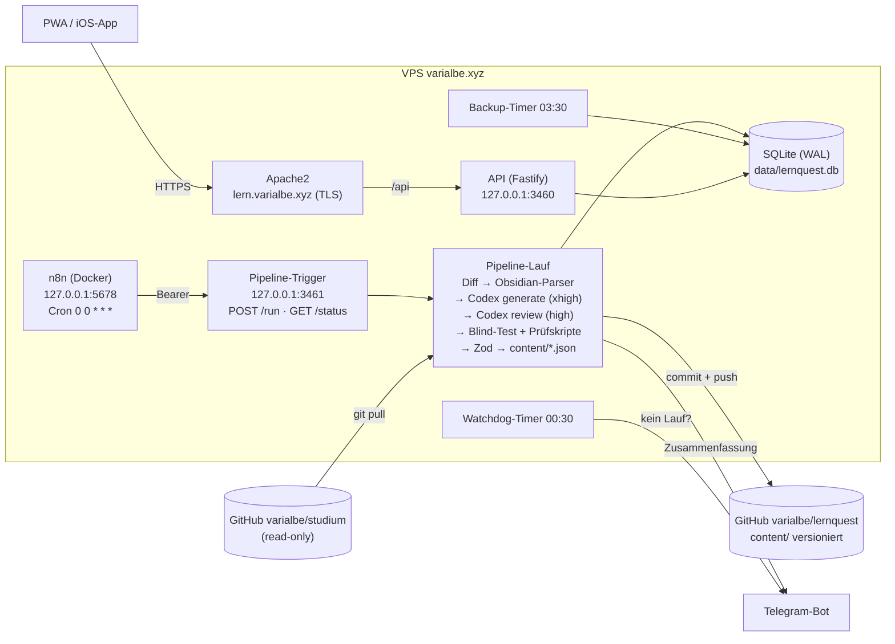

# LernQuest

Duolingo-artiges Lernquiz für **DS, EIP und ERA** (TUM). Jede Nacht um 00:00 erkennt eine Pipeline neue Vorlesungsmitschriften im privaten Repo `varialbe/studium`. Daraus erzeugt Codex CLI Multiple-Choice-Level, prüft sie in einem zweiten Durchlauf und spielt sie in die App ein. Dazu kommen Accounts, XP, Coins, Streaks, Pets, Shop und Ligen.

**App:** https://lern.varialbe.xyz · **Zugangsdaten:** `~/lernquest/CREDENTIALS.local.md` (nur auf dem Server)

## Architektur



| Ordner | Inhalt |
|---|---|
| `packages/shared` | Zod-Schemas (Quiz-Format, API-Contracts) + Spielkatalog (Pets, Shop, Achievements, Ökonomie) – single source of truth |
| `pipeline/` | CLI + Trigger-Dienst: Diff-Erkennung, Obsidian-Parser, Codex-Aufrufe, Validierung, Git, Import, Telegram |
| `pipeline/prompts/` | versionierte Prompt-Vorlagen `generate-unit.md`, `review-unit.md`, `generate-bonus.md`, `review-bonus.md` |
| `content/` | generierte Units `content/<modul>/<nr>-<slug>.json` (Quelle der Wahrheit, wird beim API-Start importiert) |
| `wissen/` | Wissenssammlung `wissen/<modul>/<unit-id>.json` (Glossar je Unit, von der API direkt gelesen) |
| `apps/api` | Fastify + Drizzle + SQLite: Auth, Fortschritt, Ökonomie, Ligen, Admin, Web Push |
| `apps/web` | React + Vite + Tailwind + motion + KaTeX + Mermaid, PWA, Capacitor (iOS) |
| `n8n/` | Docker Compose + Workflow „LernQuest Nightly“ |
| `deploy/` | systemd-Units, Apache-vhosts, Deploy- und Backup-Skript |
| `docs/` | iOS-Sideloading |

## Betrieb

```bash
cd ~/lernquest
pnpm pipeline dry-run                 # was wäre neu?
pnpm pipeline run                     # Normalbetrieb (macht n8n jede Nacht)
pnpm pipeline backfill                # alle Vorlesungen chronologisch nachholen
pnpm pipeline regenerate "DS/01_Vorlesungen/Diskrete Strukturen VO3.md"
pnpm pipeline bonus                   # fehlende Praxis-Level nachziehen (oder: bonus ds-03 → nur diese Unit neu)
pnpm pipeline knowledge [ds-03]       # Wissenssammlung für Units ohne (aktuelle) Sammlung erzeugen (oder eine Unit neu)
pnpm pipeline audit [ds-03 …]         # Blind-Test über bestehende Units, Durchgefallene neu generieren (--no-notify: ohne Telegram)
pnpm pipeline audit eip-01 --force eip-01-l1-q02,eip-01-l3-q09 --reason "Regel fehlt"   # gezielt neu generieren
pnpm pipeline watchdog                # lief heute schon ein Lauf?
pnpm pipeline telegram-setup          # einmalig: Chat-ID nach /start an den Bot eintragen

deploy/deploy-web.sh                  # Web-App + iOS-Live-Update-Paket bauen und nach /var/www/lernquest
sudo systemctl restart lernquest-api  # nach API-Änderungen
pnpm seed                             # Admin/Testuser/Einladungscode (idempotent)
pnpm test                             # alle Tests (shared, api, pipeline)
cd apps/web && npx playwright test    # Screenshots (390×844 hell/dunkel) + E2E
cd apps/web && node scripts/gen-assets.mjs   # Grafiken per Codex-Imagegen (FORCE=name für ein einzelnes Bild)
cd apps/web && node scripts/make-icons.mjs   # App-Icons aus assets-src/app-icon.png
```

**Dienste:** `lernquest-api`, `lernquest-pipeline` (Trigger), Timer `lernquest-watchdog.timer` (00:30), `lernquest-backup.timer` (03:30, `~/backups/lernquest`, 14 Tage). n8n: `docker compose --env-file ../.env up -d` in `n8n/` (siehe `n8n/README.md`, SSH-Tunnel: `ssh -N -L 5678:127.0.0.1:5678 varialbe@varialbe.xyz`).

**Logs:** `journalctl -u lernquest-api -f`, Pipeline-Läufe in `data/runs/<runId>.log`, Reports in `data/reports/`, Codex-Prompts/-Ausgaben pro Datei in `data/work/<runId>/`.

### Wie „neu“ erkannt wird
- `pipeline_state.last_sha` = zuletzt verarbeiteter Commit des Studium-Repos. Jeder Lauf: `git pull --ff-only`, dann `git diff --name-status -M <last_sha>..HEAD` auf `DS|EIP|ERA/01_Vorlesungen`, nur `*.md`.
- Jede verarbeitete Datei wird per **sha256** gemerkt: dieselbe Datei wird nie doppelt verarbeitet, auch nicht nach Umbenennung.
- Geänderte Dateien werden ignoriert, außer `REGENERATE_ON_MODIFY=true`. Fehlgeschlagene Dateien werden bis zu 3× in späteren Läufen erneut versucht.
- Ein Codex-Rate-Limit bricht den Lauf sauber ab. Die restlichen Dateien folgen im nächsten Lauf, und Telegram meldet es mit 🚦.

## Selbsttragende Fragen: Kontext, Blind-Test, Prüfskripte
Wer spielt, sieht nur Frage, Kontext und Optionen, keine Vorlesung. Deshalb:
- **`context`** (optional, `packages/shared/src/quiz.ts`): `{ type: 'mermaid' | 'code' | 'table', content, language?, caption?, frames? }`, angezeigt über der Frage. `frames` sind Schritte desselben Mermaid-Diagramms (Algorithmus-Zustände). Kontextdiagramme haben höchstens 18 Knoten (Zod, `mermaidNodeCount`); der Prompt verlangt ca. 15.
- **Prompt-Regeln** stehen einmal in `pipeline/prompts/_self-contained.md` und werden per `{{SELF_CONTAINED}}` in Generator-, Review- und Reparatur-Prompts eingesetzt: alle Daten in Frage/Kontext, keine Verweise auf „das Beispiel aus der Vorlesung“, lieber neue kleine Instanzen, Titel/Konzepte ohne LaTeX.
- **Qualitäts-Tor** (`pipeline/src/quality.ts`, nach jeder Generierung, abschaltbar mit `QUALITY_GATE=false`):
  1. **Prüfskripte**: Bei Rechen-/Algorithmus-/Code-Aufgaben liefert Codex ein Python-Skript (`verify`, nicht im Content). Die Pipeline führt es isoliert aus (`python3 -I`, 10 s Timeout) und vergleicht `ANSWER: …` mit der hinterlegten Lösung.
  2. **Blind-Test**: Ein zweiter Codex-Lauf (`CODEX_BLIND_EFFORT`, Standard `high`) bekommt nur Frage + Kontext + Optionen und löst. „Fehlende Info“ (auch bei unbeschriebenen Vorlesungsszenarien) oder eine andere Antwort = durchgefallen.
  3. **Reparatur**: Durchgefallene Fragen werden mit Befund neu generiert (`CODEX_EFFORT`), max. 2 Versuche, jeder Ersatz wieder durch 1. und 2. Danach wird verworfen und im Report geloggt. Ersatzfragen bekommen neue IDs (`…-q05-r1`), die alte Frage wird beim Import deaktiviert.
- `pnpm pipeline audit` macht dasselbe für bestehende Units (3 parallel). Report: `data/reports/audit-*.json`, Log: `data/runs/audit-*.log`.

## Üben-Tab: Wiederholen, Schwächen, Klausur-Check, Duelle
Alle drei Rundenarten stellt der **Server** zusammen (`quiz_runs`). Gewertet werden genau diese Fragen, genau einmal (`POST /api/runs/:id/complete`).
- **Schwächen** (`/api/mastery`, `POST /api/runs/weak`): Trefferquote je Konzept aus den letzten 10 Antworten (`< 60 %` unsicher, `< 85 %` fast sicher). Eine Runde zieht 10 Fragen der 4 schwächsten Konzepte, zuletzt falsch beantwortete zuerst. Leitner-Boxen laufen mit.
- **Klausur-Check** (`POST /api/runs/exam`): 20 Fragen gleichmäßig über alle Units, 45 s pro Frage, kein Feedback zwischendurch. Am Ende gibt es eine Note (TUM-Stufen, bestanden ab 50 %) und jede falsche Frage mit Lösung. Unbeantwortetes zählt als falsch, Fehler landen in der Wiederholung.
- **Duelle** (`/api/duels`): Herausfordern → selbst vorlegen → die andere Seite bekommt eine Push-Nachricht. Gleiche 10 Fragen, das Ergebnis der Gegenseite ist erst nach dem eigenen Spiel sichtbar. Sieger nach Richtigen, dann Zeit, er bekommt 15 Coins. Nach 48 h gewinnt, wer gespielt hat.
- **Tagesaufgaben** (`/api/quests`): 3 pro Person und Tag (immer XP plus 2 zufällige, deterministisch), Coins beim Einlösen.
- XP/Coins nur für die ersten 3 Schwächen-Runden, 2 Klausur-Checks und 3 Duelle pro Tag (`packages/shared/src/game.ts`: `WEAK`, `EXAM`, `DUEL`).
- **Neue Vorlesung**: Der API-Tick kündigt neue Units per Push an, aber erst ab 08:00 (der Lauf ist um Mitternacht).

## Wissenssammlung (Üben → Wissen)
Zu jeder Unit gibt es ein Nachschlagewerk mit **allen Begriffen, Konzepten, Sätzen/Regeln, Verfahren und Notationen** der Vorlesung. In der App: Üben → **Wissen** (Modul wählen, Units aufklappen oder über alle Begriffe suchen). Jeder Eintrag hat Kurzfassung, Erklärung (Markdown + KaTeX), optional Beispiel, „Achtung“ (typische Fehler) und „Siehe auch“. Konzepte unter „Schwächen“ verlinken direkt auf ihren Eintrag (`/wissen?m=DS&q=…`).
- **Erzeugung** (`pipeline/src/knowledge.ts`, Prompts `generate-knowledge.md` + `review-knowledge.md`, Schema `knowledge-output.schema.json`): Codex schreibt das Glossar aus der Mitschrift (`CODEX_EFFORT`), ein zweiter Lauf prüft fachlich und ergänzt Fehlendes (`CODEX_REVIEW_EFFORT`). Doppelte Begriffe werden verworfen, IDs vergibt die Pipeline (`ds-03-k07`).
- **Wann**: in jedem Lauf direkt nach einer neuen Unit (eigener Commit `wissen: …`). Fehlt eine Sammlung oder stammt sie von einer älteren Fassung der Unit (`sourceSha`), holt jeder normale Lauf bis zu `KNOWLEDGE_CATCH_UP` (Standard 3) nach – Fehler dabei sind nur Warnungen. Gezielt: `pnpm pipeline knowledge [unit-id]` oder im Bot **📖 Wissenssammlung nachholen**. Abschalten: `GENERATE_KNOWLEDGE=false`.
- **API**: `GET /api/knowledge/:module` liest die Dateien (Cache nach mtime), also sofort sichtbar ohne Neustart. Offline über den Service Worker (`lq-api`). Formeln in `\( \)`/`\[ \]` stellt die API auf `$`/`$$` um (KaTeX kennt nur `$`).
- **Voraussetzungen** (`wissen/<modul>/_voraussetzungen.json`, `pipeline/src/prereqs.ts`, Prompt `prereqs.md`): Codex schlägt je Eintrag die direkten Voraussetzungen vor (mit kurzer Begründung), die Pipeline prüft deterministisch: nur existierende Einträge derselben oder früherer Units, kein Selbstbezug, max. 6, keine Zyklen (Kanten auf früher Eingeführtes gewinnen). Läuft nach jeder neuen Wissenssammlung mit; fehlt der Graph für eine Unit, holt ihn Modus `knowledge` nach. In der App: „Dafür brauchst du“, „Baut darauf auf“ und **„Von Grund auf erklären“** – ein fester Lernpfad (alle Voraussetzungen topologisch sortiert, max. 12 Schritte, Grundlagen zuerst), ganz ohne Live-KI.
- **Karteikarten** (`/karten`, `apps/api/src/lib/cards.ts`, Tabelle `card_items`): vorne Begriff, hinten Kurzfassung + Erklärung; Wischen oder Buttons. Fällige zuerst, dann bis zu 10 neue in Vorlesungsreihenfolge (20 pro Runde), optional nur eine Unit. Leitner-Boxen 1–5 (1/2/4/7/14 Tage), danach „gemeistert“ (alle 30 Tage), „Nochmal“ → Box 1, morgen wieder. Gewertet wird nur die erste Antwort pro Karte und Runde.

## Wochenrückblick (Push)
Sonntags ab 18 Uhr (`RECAP` in `packages/shared/src/game.ts`) schickt der API-Tick jedem Push-Abo einmal pro Woche einen Rückblick: XP (mit Trend zur Vorwoche), Fragen + Trefferquote, Streak, bis zu zwei wackelige Konzepte, fällige Wiederholungen/Karten (`apps/api/src/lib/recap.ts`, `push_subscriptions.last_recap_week`). Nur mit aktivierten Mitteilungen und `users.weekly_recap` (Profil → „Wochenrückblick“). Die iOS-App plant ihn als lokale Mitteilung (`scheduleRecap` in `apps/web/src/lib/native.ts`, Inhalt von `GET /api/recap`, beim Öffnen neu geplant). Datenschutzerklärung Abschnitt 8 beschreibt das.

## iOS-App: Live-Updates
Die App enthält den Web-Code des Builds, holt sich aber neue Versionen selbst ([`@capgo/capacitor-updater`](https://github.com/Cap-go/capacitor-updater) im manuellen Modus, ohne Cloud):
1. `deploy/deploy-web.sh` baut zusätzlich ein App-Paket (API absolut) nach `/var/www/lernquest/app-updates/bundle-<version>.zip` und schreibt `latest.json`. Version = Commit-Hash, bei uncommitteten Änderungen plus Zeitstempel.
2. Die App fragt beim Start und beim Zurückkehren `GET /api/app/update` (über die API wegen CORS von `capacitor://localhost`). Ist die Version neu: Download, beim Start sofort aktivieren, sonst beim nächsten Wechsel in den Hintergrund.
3. Startet ein Paket nicht (kein `notifyAppReady()` innerhalb 15 s), rollt die App automatisch zurück.

**Neu kompilieren (IPA) ist nur nötig** bei neuen nativen Plugins, Berechtigungen, App-Icon/Name oder einer neuen Capacitor-Version. Eingebaut sind schon: Updater, lokale Mitteilungen, Haptik, Statusleiste, App-Lifecycle. Die installierte Version steht im Profil unter „App-Version“.

## Praxis-Bereich (Bonus-Level)
Zu jeder Unit erzeugt die Pipeline nach den vier Hauptleveln ein fünftes Level `kind: "bonus"` (Tab **Praxis**). Es steht außerhalb des Lernpfads und wird nach „Grundlagen“ der Unit freigeschaltet.
- **Transferfragen** (`single`/`multi`/`truefalse`): „Wo steckt das im echten Leben?“, also Alltags- und Berufsszenarien zum Konzept der Vorlesung.
- **Schätzfragen** (`estimate`): Antwort per Schieberegler. `slider = {min, max, step, answer, tolerance, unit, scale: linear|log}`. Richtig ist alles innerhalb `answer ± tolerance`. Nach dem Prüfen zeigt der Regler den Toleranzbereich. Die Pipeline verteilt sie gleichmäßig im Level.
- Eigener Prompt plus Review mit `bonus-output.schema.json`. Zod prüft z. B.: `answer` liegt im Bereich, Toleranz ≤ ⅓ der Spanne, log-Skala braucht `min > 0`. Ein Level braucht mindestens 8 gültige Fragen.
- Schlägt das Praxis-Level fehl, bleibt die Unit trotzdem gültig. Der Report vermerkt es, und `pnpm pipeline bonus` holt es nach. Abschalten mit `GENERATE_BONUS=false`.

## Backups
Jede Nacht um 03:30 läuft `lernquest-backup.service`:
1. **Lokal** (`deploy/backup-db.sh`): konsistente SQLite-Kopie mit Integritätsprüfung nach `~/backups/lernquest/`, 14 Tage.
2. **Außer Haus** (`deploy/backup-offsite.sh`): mit [`age`](https://age-encryption.org) verschlüsselt ins private Repo **`varialbe/lernquest-backups`**. Jede Version ist ein Commit.
   - täglich `lernquest.tar.age`: Datenbank, `.env`, `CREDENTIALS.local.md`
   - sonntags `n8n.tar.age`: n8n-Datenbank und -Konfiguration
3. Schlägt etwas fehl, kommt eine Telegram-Warnung (`lernquest-backup-alert.service`).

Der **private Schlüssel** liegt auf dem Server in `~/.config/lernquest/backup-age.key` und muss **zusätzlich außerhalb** aufbewahrt werden (Passwort-Manager). Ohne ihn ist kein Backup lesbar.

**Wiederherstellen** (auf einem neuen Server: erst Repo klonen und `pnpm install`):
```bash
git clone https://github.com/varialbe/lernquest-backups.git && cd lernquest-backups
git log --oneline                       # gewünschte Version wählen, ggf. git checkout <commit>
age -d -i backup-age.key -o l.tgz lernquest.tar.age && tar -xzf l.tgz
sudo systemctl stop lernquest-api lernquest-pipeline
gunzip -c lernquest/lernquest.db.gz > ~/lernquest/data/lernquest.db && rm -f ~/lernquest/data/lernquest.db-{wal,shm}
cp lernquest/env ~/lernquest/.env && cp lernquest/CREDENTIALS.local.md ~/lernquest/ && chmod 600 ~/lernquest/.env ~/lernquest/CREDENTIALS.local.md
sudo systemctl start lernquest-api lernquest-pipeline
# n8n: age -d … n8n.tar.age | tar -xz, Inhalt von n8n/ ins Volume n8n_n8n_data, Container neu starten
```
Die Fragen selbst (`content/`) liegen ohnehin versioniert im Haupt-Repo.

## Troubleshooting

| Problem | Lösung |
|---|---|
| Keine Telegram-Nachrichten | `TELEGRAM_CHAT_ID` leer? → dem Bot `/start` schreiben, `pnpm pipeline telegram-setup`. Bis dahin: Admin-Bereich → Hinweise. |
| Nächtlicher Lauf fehlt | `docker ps` (lernquest-n8n?), Workflow aktiv?, `systemctl status lernquest-pipeline`, `curl 127.0.0.1:3461/health` |
| „Pipeline läuft bereits“ | `cat data/pipeline.lock`. Ist der Prozess tot, wird das Lock automatisch ignoriert. |
| Datei dauerhaft `failed` | Admin → Übersicht zeigt den Grund; nach Fix: `pnpm pipeline regenerate "<pfad>"` |
| Codex nicht eingeloggt | `codex login status`, ggf. `codex login` |
| Eine Frage ist falsch | In der App melden → Admin → Meldungen → „Frage deaktivieren“ (bleibt auch nach Re-Import deaktiviert) |
| API startet nicht | `journalctl -u lernquest-api -n 50`; ungültige `content/*.json` werden beim Start übersprungen und geloggt |
| PWA-Icons 404 unter `/icons/` | Apache hat global `Alias /icons/` (autoindex). Deshalb liegen die App-Icons unter `/app-icons/`. |
| Google-Login: „redirect_uri_mismatch“ | Callback-URLs (siehe „Konten, Google, E-Mails“) in der Google Cloud Console unter „Autorisierte Weiterleitungs-URIs“ eintragen; OAuth-Zustimmungsbildschirm auf „In Produktion“ |
| Mails kommen nicht an | `sudo tail -f /var/log/mail.log` (status=sent?, DKIM-Signature field added?), Spam-Ordner |
| Bot antwortet nicht | `systemctl status lernquest-bot`, `journalctl -u lernquest-bot -n 50`; nur der Chat aus `TELEGRAM_CHAT_ID` wird bedient |
| Zertifikat | `sudo certbot renew --cert-name lern.varialbe.xyz --dry-run` (Renew-Hook lädt Apache neu) |
| Backup kam nicht an | `journalctl -u lernquest-backup -n 50`; `git -C ~/backups/lernquest-offsite log -3` |
| Backup zurückspielen | `sudo systemctl stop lernquest-api lernquest-pipeline`, `gunzip -c ~/backups/lernquest/<datei>.db.gz > data/lernquest.db`, `rm -f data/lernquest.db-wal data/lernquest.db-shm`, Dienste starten |

## Wie füge ich einen neuen Fragetyp hinzu?
1. `packages/shared/src/quiz.ts`: Typ in `QUESTION_TYPES` ergänzen, Regeln in `Question.superRefine` (z. B. Anzahl Optionen/Antworten), Test in `packages/shared/test/`.
2. `pipeline/schemas/unit-output.schema.json`: Typ ins `enum` aufnehmen.
3. `pipeline/prompts/generate-unit.md` und `review-unit.md`: Typ beschreiben (wann, wie viele, Format) → `promptVersion` in `pipeline/src/config.ts` hochzählen.
4. `apps/web/src/pages/Quiz.tsx`: Label in `TYPE_LABEL`, ggf. eigenes Rendering (wie `TrueFalse`, die Lücke bei `cloze` oder `EstimateInput` für `estimate`). Bewertung immer über `checkAnswer` in `quiz.ts` (Client und Server).
5. Bestehende Units bleiben gültig; neue Fragen dieses Typs entstehen mit `pnpm pipeline regenerate <datei>` oder beim nächsten neuen Material.

## Wie ändere ich das Modell?
In `~/lernquest/.env`:
```
CODEX_MODEL=gpt-6-luna        # Modell für Generierung, Review, Blind-Test und Reparatur
CODEX_EFFORT=xhigh            # Reasoning-Effort Generierung
CODEX_REVIEW_EFFORT=high      # Reasoning-Effort Review
CODEX_TIMEOUT_MIN=30
```
Keine Neustarts nötig. Jeder Lauf liest `.env` neu. Das verwendete Modell steht in jeder Unit unter `generator`.

## Sicherheit (Audit 31.10.2026)
- **SQL-Injection**: nur Drizzle-Queries bzw. `sql`-Templates mit Parametern, kein String-Bau. Test: `apps/api/test/security.test.ts`.
- **Zugriffsschutz**: jede Route außer der Liste `PUBLIC` im Sicherheitstest braucht Anmeldung, jede `/api/admin/*`-Route die Admin-Rolle – der Test geht alle registrierten Routen automatisch durch (neue Route ohne Schutz → Test rot).
- **XSS**: React escaped alles; `dangerouslySetInnerHTML` nur für KaTeX (ohne `trust`), Mermaid (`securityLevel: 'strict'`) und ein festes SVG. Mails escapen Namen. Strenge CSP (`script-src 'self'`), `X-Frame-Options: DENY`.
- **Mail-Links**: Reset-/Bestätigungslinks nur auf Domains aus `WEB_ORIGIN` (kein Host-Header-Poisoning).
- **KI-Prüfskripte** (`pipeline/src/sandbox.py`): Limits für Speicher/CPU/Dateien, Audit-Hook blockiert Netzwerk, Prozesse, ctypes, Schreiben und Lesen außerhalb von Python/Arbeitsordner, leere Umgebung (keine Secrets). Test: `pipeline/test/sandbox.test.ts`. Kein Container – bwrap ginge nur mit gelockerter User-Namespace-Sperre.
- **Abhängigkeiten**: `pnpm audit --prod` sauber (katex per `pnpm.overrides`).
- **Server**: `data/` und `~/backups/lernquest` nur für `varialbe` (700/600). fail2ban-Jails `sshd`, `postfix-sasl`, `dovecot` (`/etc/fail2ban/jail.d/mail.local`, Sperre 1 Tag, steigend).

## Konten, Google, E-Mails
- **Registrieren** mit Benutzername + E-Mail + Passwort oder **mit Google**. Einladungscode ist optional (zeigt dem Admin nur, wer wen eingeladen hat). Datenschutz-Bestätigung ist Pflicht, Zeitpunkt wird gespeichert.
- **Anmelden** mit Benutzername oder E-Mail, Passkey oder Google. „Passwort vergessen?“ schickt einen Link (1 h gültig, einmalig).
- **Datenschutz in der DB** (`apps/api/src/lib/crypto.ts`): E-Mails nur AES-256-GCM-verschlüsselt (`DATA_KEY`), Suche per HMAC (`EMAIL_HASH_KEY`), Einmal-Tokens nur als SHA-256, Passwörter Argon2id. **`DATA_KEY`/`EMAIL_HASH_KEY` nie ändern** – sonst sind alle Adressen unlesbar (sie stecken im verschlüsselten Offsite-Backup der `.env`).
- **Google** (`apps/api/src/routes/account.ts`): Authorization Code + PKCE, `GOOGLE_CLIENT_ID/SECRET` in `.env`. Callback-URLs (in der Google Cloud Console eintragen): `https://lern.varialbe.xyz/api/auth/google/callback` und `https://mateenbatt.de/lernen/api/auth/google/callback`. Die iOS-App öffnet Google in Safari und holt das Ergebnis per Polling ab (Google verbietet Logins in eingebetteten WebViews). Gleiche, dort bestätigte E-Mail → Konto wird automatisch verknüpft.
- **E-Mails** per SMTP an den lokalen Postfix (`127.0.0.1:25`, DKIM `mail2026`): Account-Mails von `lernquest.reset@varialbe.xyz`, Newsletter von `news.quest@varialbe.xyz` (beide Aliase → `varialbe`, also Antworten/Bounces landen im normalen Postfach). Nicht über `sendmail`: die Dienste laufen mit `NoNewPrivileges`.
- **Admin → Nutzer**: Suche, Details (E-Mail, Anmeldearten, Sitzungen, Einladung, Newsletter), Bearbeiten, Reset-Mail, temporäres Passwort, Sperren, Abmelden erzwingen, Google trennen, Admin-Rolle, Fortschritt zurücksetzen, Konto löschen.

## Telegram-Bot: neue Inhalte sofort holen
Statt bis zum n8n-Lauf um 00:00 zu warten: im Bot **🔄 Neue Inhalte holen**, `/fetch` (auch `/hol`, `/update`) oder einfach eine Nachricht wie „hol die neuen Sachen“. Der Bot startet über den Trigger-Dienst (`127.0.0.1:3461`, `PIPELINE_TOKEN`) denselben Lauf wie n8n und aktualisiert seine Nachricht alle 20 s mit den letzten Log-Zeilen. Am Ende kommt die gewohnte Zusammenfassung der Pipeline. Läuft schon etwas, zeigt er diesen Lauf.
- **🔍 Was ist neu?** (`/neu`): Vorschau (dry-run), was verarbeitet würde – mit Button „Jetzt holen“.
- **📡 Status** (`/status`): laufender Lauf live bzw. die letzten Läufe; dort **📖 Wissenssammlung nachholen** (`/wissen`, Modus `knowledge`).
- Code: `apps/api/src/bot.ts`, `apps/api/src/lib/botPipeline.ts`.

## Newsletter (Double-Opt-in, Telegram-Bot)
- Anmeldung (Registrierung oder Profil) → Bestätigungs-Mail → erst nach Klick `newsletter = true` (Zeitpunkte als Nachweis). Jede Ausgabe hat einen signierten Abmeldelink plus `List-Unsubscribe` (One-Click).
- Verwaltet über den Bot **`lernquest-bot`** (systemd, Long-Polling, reagiert nur auf `TELEGRAM_CHAT_ID`):
  Bedienung über Buttons: `/start` (oder einfach eine Nachricht) öffnet das Menü → **📝 Neuer Newsletter** (Betreff, dann Inhalt als Nachricht/Markdown oder Datei `.md`/`.html`/`.txt`) → Entwurf-Karte mit **Betreff ändern · Inhalt ersetzen · Testmail + Vorschau** (an `NEWSLETTER_TEST_TO`) **· Senden** (mit Rückfrage) **· Löschen**; dazu **📂 Entwürfe** und **📊 Übersicht**. Eine Datei ohne offenen Schritt wird direkt ein neuer Entwurf. Die alten `/newsletter …`-Befehle gehen weiter als Abkürzung.
- Layout und Footer (Abmelden, Impressum, Datenschutz, ©) kommen automatisch dazu (`apps/api/src/lib/mail.ts`).
- Logs: `journalctl -u lernquest-bot -f`.

## Passkeys und Passwörter
- **Passkeys** (WebAuthn, `apps/api/src/routes/passkeys.ts`): Relying Party ist `WEB_ORIGIN` (lern.varialbe.xyz). Anlegen unter Profil → Passkeys, Anmelden per Button oder direkt als Vorschlag im Benutzernamen-Feld. Funktioniert in Safari und der Home-Screen-App.
- **iOS-App (LiveContainer/Sideloading)**: keine Passkeys und kein „Passwort sichern“-Dialog. Beides bräuchte das Entitlement *Associated Domains* (`webcredentials:lern.varialbe.xyz`) mit einer Team-ID, und das gibt es nur mit bezahltem Developer-Account. Ein Neukompilieren ändert daran nichts. Passwörter lassen sich dort über die QuickType-Leiste aus der Passwörter-App einfügen.
- Die Formulare haben `autocomplete`-Attribute (`username`, `current-password`, `new-password`), damit die Passwörter-App in Safari/PWA anbietet, das Passwort zu sichern und auszufüllen.

## Sound und Haptik (iOS)
- `ensureAudio()` (`apps/web/src/lib/sound.ts`): Ein geschlossener oder von iOS unterbrochener AudioContext (`interrupted`, z. B. nach einem Mitteilungston) wird neu erzeugt, sonst `resume()`. Das passiert vor jedem Sound, bei `pointerdown`/`touchend` und bei der Rückkehr in die App.
- Haptik (`apps/web/src/lib/native.ts`): In der iOS-App läuft sie über Capacitor-Haptics mit einem vorbereiteten Generator, der bei jeder Rückkehr neu angelegt wird. Fallback ist `vibrate()`, Fehler landen als Admin-Hinweis. In Safari/PWA gibt es auf dem iPhone kein `navigator.vibrate`; ab iOS 18 löst ein verstecktes `<input type="checkbox" switch>` das System-Haptik-Feedback aus.

## Sicherheit
- Registrierung nur mit Einladungscode, argon2id, Rate-Limits auf Login/Registrierung, widerrufbare Session-Tokens (gehasht in der DB).
- Gewertet wird nur auf dem Server: Der Client schickt seine Auswahl, der Server prüft gegen die DB und berechnet XP, Coins, Streak und Shop-Käufe. Shop-Käufe laufen als Transaktion mit bedingtem UPDATE.
- API, Trigger und n8n lauschen nur auf 127.0.0.1. Nach außen geht nur Apache (TLS, HSTS, CSP).
- Secrets nur in `.env` / `CREDENTIALS.local.md` (beide gitignored, `chmod 600`).
